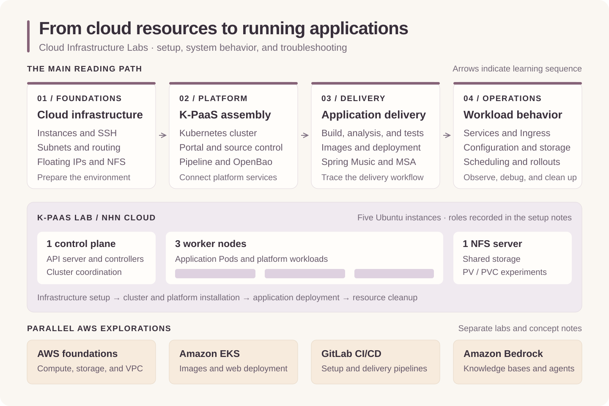

# Cloud Native Labs

Cloud-native concepts and hands-on labs covering Kubernetes, cloud platforms, CI/CD, and AWS services. The central thread is understanding how virtual machines, networking, and shared storage support a container platform—and how applications are built, deployed, exposed, and operated on that platform.

The main lab sequence follows a K-PaaS environment on NHN Cloud: infrastructure preparation, cluster installation, platform services, application delivery, and Kubernetes operations. Separate AWS labs explore Amazon EKS, GitLab CI/CD, and Amazon Bedrock. Concept notes connect these experiments to cloud-native architecture and distributed systems.



## What This Repository Explores

- **Infrastructure foundations:** instances, subnets, routing, floating IPs, SSH access, and NFS shared storage.
- **Platform assembly:** a Kubernetes control plane and worker nodes, followed by K-PaaS portal, pipeline, source control, and OpenBao configuration.
- **Application delivery:** container images, build and test jobs, deployment pipelines, Spring Music, and sample microservices.
- **Workload behavior:** Pods and controllers, configuration and secrets, Services and Ingress, persistent volumes, scheduling, rolling updates, and rollback.
- **Troubleshooting:** recorded errors and attempted fixes alongside commands, manifests, and screenshots from the original labs.

## Suggested Reading Path

Follow the K-PaaS sequence to see how the infrastructure and platform components fit together, then use the Kubernetes labs to examine individual behaviors in more depth.

| Step | Document | Focus |
| --- | --- | --- |
| 1 | [Cloud-Native Fundamentals](concepts/cloud-native-fundamentals.md) | Cloud service models, containers, microservices, and DevOps |
| 2 | [K-PaaS Infrastructure Setup](labs/kpaas/infrastructure-setup.md) | Five instances, network configuration, SSH, and NFS |
| 3 | [Cluster Installation and Networking](labs/kpaas/cluster-installation-and-networking.md) | Cluster installation, portal deployment, and Ingress connectivity |
| 4 | [Portal, Pipeline, and Source Control](labs/kpaas/portal-pipeline-and-source-control.md) | Platform services for application delivery |
| 5 | [Spring Music Deployment](labs/kpaas/spring-music-deployment.md) | Build, analysis, test, and deployment jobs; recorded deployment issues |
| 6 | [Kubernetes CLI and Microservices](labs/kpaas/kubernetes-cli-and-microservices.md) | Resource management and a sample microservices delivery workflow |
| 7 | [Services and Ingress](labs/kubernetes/services-and-ingress.md) / [Persistent Storage](labs/kubernetes/persistent-storage.md) | Application traffic paths and data persistence |
| 8 | [Scheduling and Rollouts](labs/kubernetes/scheduling-and-rollouts.md) | Node scheduling, taints, tolerations, updates, and rollback |
| 9 | [Platform Teardown and Nginx](labs/kpaas/platform-teardown-and-nginx.md) | Platform resource cleanup and a standalone Nginx experiment |

## Document Index

### Concepts

| Document | Topics |
| --- | --- |
| [Cloud-Native Fundamentals](concepts/cloud-native-fundamentals.md) | IaaS, PaaS, SaaS, microservices, containers, DevOps |
| [AWS Infrastructure](concepts/aws-infrastructure.md) | Regions and Availability Zones, compute, load balancing, storage, data transfer, VPC |
| [Containers and Kubernetes](concepts/containers-and-kubernetes.md) | Container runtimes, Docker, cluster architecture, workloads, networking, storage |
| [Saga Pattern](concepts/saga-pattern.md) | Distributed transactions, compensation, choreography, orchestration, trade-offs |

### K-PaaS Platform Labs

The infrastructure setup records five Ubuntu instances on NHN Cloud: one control plane, three workers, and one NFS server. These documents follow the environment through installation, application delivery, and cleanup.

| Document | Topics |
| --- | --- |
| [Infrastructure Setup](labs/kpaas/infrastructure-setup.md) | Key pairs, subnets, route tables, instances, floating IPs, NFS, SSH keys |
| [Cluster Installation and Networking](labs/kpaas/cluster-installation-and-networking.md) | K-PaaS cluster installation, portal deployment, Ingress-NGINX, network interfaces |
| [Portal, Pipeline, and Source Control](labs/kpaas/portal-pipeline-and-source-control.md) | Portal configuration, pipeline installation, source control |
| [Spring Music Deployment](labs/kpaas/spring-music-deployment.md) | OpenBao, kubeconfig, delivery pipeline, container image and deployment troubleshooting |
| [Kubernetes CLI and Microservices](labs/kpaas/kubernetes-cli-and-microservices.md) | Namespaces, Pods, Services, Deployments, microservices, SCM, pipelines |
| [Platform Teardown and Nginx](labs/kpaas/platform-teardown-and-nginx.md) | Platform component removal, Nginx deployment, Service exposure, connectivity |

### Kubernetes Labs

| Document | Topics |
| --- | --- |
| [Pods, Deployments, and Services](labs/kubernetes/pods-deployments-and-services.md) | Pod creation, replica maintenance, recovery, Services, multiple containers |
| [ReplicaSets, Jobs, and CronJobs](labs/kubernetes/replicasets-jobs-and-cronjobs.md) | Replica control, sequential and parallel jobs, scheduled tasks |
| [ConfigMaps, Secrets, and DaemonSets](labs/kubernetes/configmaps-secrets-and-daemonsets.md) | Environment variables, mounted configuration and secrets, node-level workloads |
| [Services and Ingress](labs/kubernetes/services-and-ingress.md) | ClusterIP, LoadBalancer, Ingress, internal connectivity, path and host routing |
| [Persistent Storage](labs/kubernetes/persistent-storage.md) | emptyDir, hostPath, PV, PVC, StorageClass, local and NFS volumes, static and dynamic provisioning |
| [Scheduling and Rollouts](labs/kubernetes/scheduling-and-rollouts.md) | Cordon and uncordon, taints and tolerations, rolling updates, rollback, StatefulSets, Jobs |

### AWS Labs

| Document | Topics |
| --- | --- |
| [EKS Web Application](labs/aws/eks-web-application.md) | kubectl, eksctl, container images, Amazon ECR, EKS, microservices deployment |
| [GitLab CI/CD](labs/aws/gitlab-ci-cd.md) | GitLab setup, application preparation, pipeline configuration |
| [Bedrock Knowledge Bases and Agents](labs/aws/bedrock-knowledge-bases-and-agents.md) | S3 data sources, knowledge bases, retrieval, RAG, agents, Strands Agents SDK |

## Repository Layout

```text
cloud-native-labs/
├── README.md
├── concepts/                  # Explanations and architecture notes
├── labs/
│   ├── aws/                   # AWS application and service experiments
│   ├── kpaas/                 # Infrastructure, platform setup, and delivery
│   └── kubernetes/            # Workload, networking, storage, and operations labs
└── assets/
    └── diagrams/              # SVG diagrams
```

Documents are organized by topic rather than session date. Original dates remain in document metadata. This is a documentation repository containing recorded commands, manifests, observations, and illustrations.

## Documentation Scope

The README, document titles, and section headings are in English. Original document bodies, code blocks, metadata, and image references are retained in their original language and form; internal link paths are updated for the new layout.

Most screenshots are embedded through their original external URLs. Five existing Obsidian image references have no corresponding files in the repository or its available Git history; those references are retained in the [cluster installation](labs/kpaas/cluster-installation-and-networking.md) and [scheduling](labs/kubernetes/scheduling-and-rollouts.md) documents. A few original note links also point to documents absent from the repository.

## Background

These notes originated in the Soongsil University Co-op AI Cloud Track, organized by the Spartan Software Education Institute, from December 22, 2025, to January 14, 2026. The repository organizes that work around the infrastructure concepts, platform components, and application workflows explored during the program.
